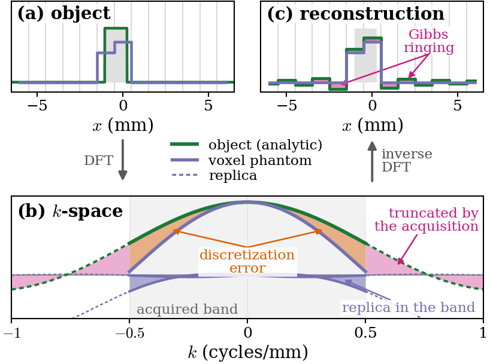
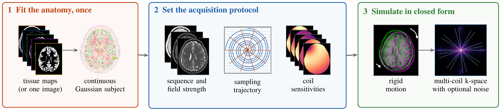

# AnalyticalGaussMRI

**Continuous Representation Before Reconstruction: An Analytical Framework for 3D Parallel MRI Simulation**

Voxel-based MRI simulation can introduce discretization and motion-resampling
errors before reconstruction even starts. We fit the anatomy once as a continuous
mixture of 3D Gaussians, then evaluate its k-space directly. The same geometry
supports different tissue contrasts, sampling trajectories, receive coils, and
rigid poses through analytical operators implemented in PyTorch/CUDA.

<p align="center"></p>

*Figure 1. Discretization errors motivate continuous simulation.*

**One figure, four connected effects:**

- **Inverse crime:** the same voxel phantom is recovered exactly in (a) and (c), hiding the continuous-object mismatch.
- **Truncation and ringing:** discarded frequencies in (b) lead to Gibbs ringing in (c).
- **Spectral replicas:** voxel sampling introduces replicas that overlap the acquired band in (b).
- **Discretization error:** voxel averaging in (a), together with spectral replication, changes the in-band signal in (b).



*Figure 2. Analytical MRI simulation with Gaussian representations and Fourier coil modulation.*

## Install

Linux, Python 3.10+, an NVIDIA GPU, a CUDA toolkit with `nvcc`, and a C++ compiler
are required. Install a CUDA-enabled PyTorch build compatible with your toolkit
first, then:

```bash
python -m pip install -e '.[paper]'
export CUDA_HOME=/usr/local/cuda  # replace with your toolkit location
source scripts/env_gpu_nufft.sh
```

CUDA extensions compile on first use into PyTorch's cache. Set
`TORCH_EXTENSIONS_DIR` to a writable directory on shared systems. There is no CPU
training fallback. Mesh construction and plotting use CPU routines; fitting and
analytical acquisition use CUDA. For a core-library installation, omit `[paper]`.
The paper extra pins MRI-NUFFT to the public commit used by the reconstruction scripts.

## Reproduce the paper

Run commands from the repository root. BrainWeb is downloaded separately;
no anatomy, checkpoints, or precomputed experiment results are bundled.

```bash
python scripts/reproduce.py all --dry-run  # inspect commands; does not run experiments
python scripts/reproduce.py download
python scripts/reproduce.py fit --device cuda:0
python scripts/reproduce.py shepplogan --device cuda:0
python scripts/reproduce.py discretization --device cuda:0
python scripts/reproduce.py gibbs --device cuda:0
python scripts/reproduce.py coils --device cuda:0
python scripts/reproduce.py motion --device cuda:0
python scripts/reproduce.py figures
```

The runner records commands and logs
under `outputs/logs/`. Start with fresh outputs when refitting.

The fit uses BrainWeb subject 04, eleven 0.5 mm tissue maps, the fixed budget in
`configs/brainweb_budget.json`, and 1500 steps per tissue. Consult [BrainWeb](https://brainweb.bic.mni.mcgill.ca/)
for data-use terms.

The scripts preserve the paper settings: 300 k initial Gaussians and TV weight
1e-4 for Shepp–Logan; 1/0.5 mm voxel-average baselines; 30 radial LSQR iterations
with a density-adjoint initialization; 20 coils with 125 Fourier modes; and eight
motion trajectories. Run Cartesian before radial so noise power is calibrated to
your fitted object.

| Paper result | Stage | Output under `outputs/` |
|---|---|---|
| Table 1 and Fig. 3: representation benchmark | `shepplogan` | `shepplogan_bench/`, `tables/shepplogan.json` |
| Fig. 4: Gibbs ringing | `gibbs` | `sim/gibbs_demo/` |
| Fig. 5: Cartesian/radial noise study | `discretization` | `sim/aliasing_recon_noise/` |
| Section 3.3: 20-coil encoding cost | `coils` | `sim/bench_parallel_radial/` |
| Fig. 6: rigid motion | `motion` | `sim/motion_aphabamas/` |

## Structure

```text
gaussmrisim/   Gaussian representation, fitting, encoding, coils, motion, tissue physics
experiments/   paper benchmarks and Figures 3–6
scripts/       data download, unified runner, CUDA environment helper
configs/       paper's per-tissue primitive budget
docs/assets/   the two README illustrations
```

Positions are `(x, y, z)` in mm; volumes are `[z, y, x]`; frequencies are cycles/mm.

## Related work and code acknowledgement

We acknowledge M. Guerquin-Kern, L. Lejeune, K. P. Pruessmann, and M. Unser,
“Realistic Analytical Phantoms for Parallel Magnetic Resonance Imaging,”
*IEEE Transactions on Medical Imaging*, 31(3), 626–636, 2012,
[doi:10.1109/TMI.2011.2174158](https://doi.org/10.1109/TMI.2011.2174158),
and their [MATLAB analytical MRI phantom software](https://bigwww.epfl.ch/algorithms/mriphantom/)
([source repository](https://github.com/Biomedical-Imaging-Group/realistic-analytical-phantom)),
which we consulted as a reference implementation.

The polyhedral benchmark separately follows Ngo et al., “Realistic analytical
polyhedral MRI phantoms,” *Magnetic Resonance in Medicine*, 76(2), 663–678, 2016,
and the [polyphantom MATLAB/MEX implementation](https://github.com/trimngo/polyphantom).
The polyhedral reference was already 3D; our CUDA implementation and tetrahedral
comparison do not claim that extension. Other foundations include Koay et al.
(MRM, 2007; 3D Shepp–Logan), Aubert-Broche et al. (TMI, 2006; BrainWeb),
[MRI-NUFFT](https://github.com/mind-inria/mri-nufft), and
[cuFINUFFT](https://github.com/flatironinstitute/finufft).

## Citation and license

Please cite the accompanying manuscript when using this code.

Code is licensed under [Apache-2.0](LICENSE).
